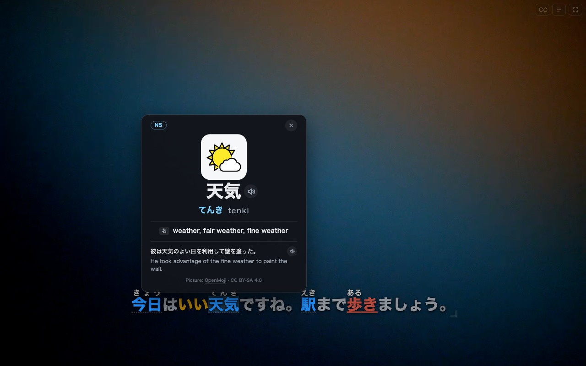

# Visual Grammar Subtitles

把你自己已有的字幕文件叠到任意网页视频上，并按语法给文字上色——让看视频变成可读的语法输入。



## 是什么

Chrome MV3 扩展。它不提供视频，也不提供字幕：你导入本地 `.srt` / `.vtt` / `.ass`，或从公共字幕站（kitsunekko、SubDL）抓取，扩展负责把字幕精确地贴在 `<video>` 元素上，并按语言包做离线分词与着色。

## 解决什么问题

看外语视频时，字幕是一整块黑话。把词性、句子成分、词组切分直接涂在字幕上，你不需要暂停查词就能看见句式；配合「原文常显 + 译文短时显示」「广告位补偿」「整片时间偏移」，可以连续追剧而不打断。

- **字幕层**：拖动 / 缩放、双层译文、时间偏移、按页面路径保存位置与样式。
- **语言包**（日 / 英 / 泰）：词性着色、振假名、短语与句法分块，完全离线。
- **词汇卡**：日语 JLPT N1–N5、英语 ECDICT、泰语词表；悬停或点击触发。
- **字幕库**：批量导入文件夹或 zip，按番剧归包；首次进入可自动匹配。
- **站点规则**：URL 模板解析番剧 / 季 / 集，自动选集、记录内嵌广告并补偿时间轴。

## 快速开始

需要 Node 20+、pnpm。

```bash
pnpm install
pnpm build
```

Chrome → `chrome://extensions` → 打开「开发者模式」→「加载已解压的扩展程序」→ 选择 `.output/chrome-mv3/`。

打开任意带视频的页面，鼠标移到画面上，右上出现 `字` 按钮即是入口。首次使用先在选项页「字幕包」导入字幕，或直接从公共站搜索。

## 开发

```bash
pnpm dev          # WXT 开发模式
pnpm typecheck    # tsc --noEmit
pnpm test         # Vitest
pnpm e2e          # Playwright，需先 pnpm build
pnpm storybook    # 设计系统，localhost:6006
```

## 数据来源

扩展不含任何视频与字幕内容。日语词典来自 JMdict / open-anki-jlpt-decks（CC BY-SA 4.0），英语、泰语词表来源与许可，以及第三方代码声明见 [NOTICE.md](NOTICE.md)。隐私说明见 [privacy/index.html](privacy/index.html)。
